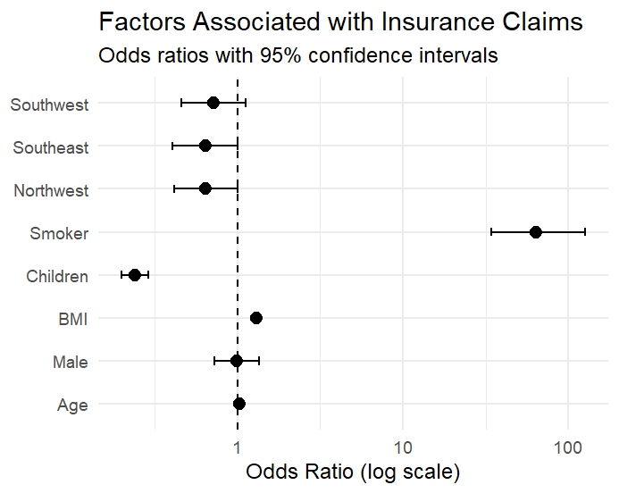
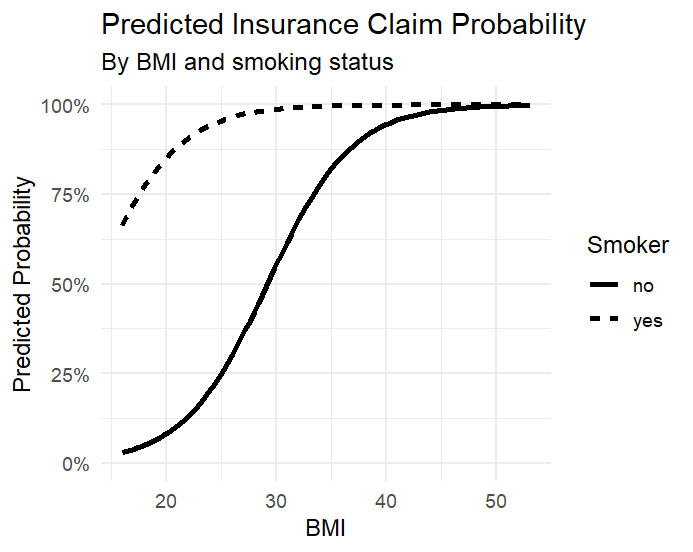
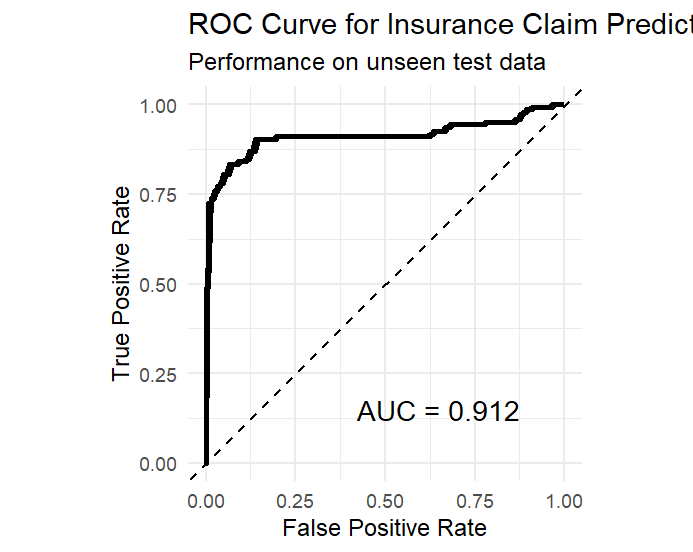

# Insurance Claim Prediction in R

An R project using logistic regression to analyse which policyholder characteristics are associated with insurance claims and how accurately claim status can be predicted.

## Tools

- R
- Logistic regression
- ggplot2
- pROC
- broom

## Question

Which policyholder characteristics are associated with making an insurance claim, and how accurately can claim status be predicted?

## Data

The dataset contains 1,338 observations. The characteristics available are:

- Age
- Sex
- BMI
- Number of children
- Smoking status
- Region
- Medical charges
- Insurance claim status

The data comes from the [Sample Insurance Claim Prediction Dataset](https://www.kaggle.com/datasets/easonlai/sample-insurance-claim-prediction-dataset), a modified version of the Medical Cost Personal Dataset. The claim variable was added to the original dataset, although its exact construction is not clearly documented.

Medical charges were excluded from the model because they may contain information that would only be known after a claim has occurred. Including them could therefore give the model information that would not realistically be available when predicting whether someone will make a claim.

## Method

I first explored how claim rates differed across the policyholder characteristics before fitting a logistic regression model.

The main stages of the analysis were:

- Comparing claim rates across different policyholder groups
- Fitting a logistic regression model using age, sex, BMI, children, smoking status and region
- Using odds ratios and 95% confidence intervals to interpret the model
- Splitting the data 80/20 into 1,070 training observations and 268 test observations
- Using the training sample to predict claim probabilities for the unseen test observations
- Evaluating the predictions using accuracy, sensitivity, specificity and ROC/AUC

A probability threshold of 0.5 was used to classify each test observation as a claim or non-claim.

## Results

The model achieved the following results on the 268 unseen test observations:

- **Accuracy:** 86.6%
- **Sensitivity:** 90.3%
- **Specificity:** 82.1%
- **AUC:** 0.912

The model correctly classified **86.6% of the test observations**, compared with **54.1%** from simply predicting the majority class for every observation.

Smoking had by far the largest estimated association with claim status. BMI and age were also positively associated with the odds of making a claim, while the number of children had a negative association.

There was little evidence of a difference between males and females after controlling for the other characteristics. Regional differences were also much weaker once the other variables were included in the model.

## Model Interpretation

The odds ratio plot shows how each characteristic is associated with the odds of making a claim, while holding the other variables constant. An odds ratio above 1 indicates higher odds of a claim, while an odds ratio below 1 indicates lower odds.

Smoking had by far the largest positive association. Smokers had around **64 times the estimated odds of making a claim** compared with non-smokers, with the other characteristics held constant.

BMI had an odds ratio of **1.30**, meaning that a one-point increase in BMI was associated with around a **30% increase in the odds of making a claim**. Age had a smaller positive association, with each additional year associated with around a **2.9% increase in claim odds**.

The number of children showed a strong negative association. Each additional child was associated with around **76% lower odds of making a claim**.

The 95% confidence intervals show the uncertainty around each estimate. If an interval contains an odds ratio of 1, there is not clear evidence of an association at the 5% significance level. This was the case for sex and most of the regional effects, while the intervals for smoking, BMI, age and children did not contain 1.

## Predicted Claim Probability

This graph shows how predicted claim probability changes with BMI for smokers and non-smokers, while holding the other characteristics constant. For both groups, a higher BMI is associated with a higher predicted probability of making a claim, with the probability rising particularly quickly through the middle of each curve.

Smoking creates a clear difference in how soon these high probabilities are reached. At a BMI of around 32, a smoker already has a very high predicted probability of claiming, while a non-smoker only reaches a similar level at a much higher BMI of over 45. This means that two otherwise similar individuals with the same BMI can have very different predicted claim probabilities depending on whether they smoke.

## Predictive Performance

The ROC curve shows the model's ability to distinguish between claims and non-claims across different probability thresholds. The further the curve is above the diagonal line, the better the model is at separating the two groups.

The model achieved an AUC (Area Under the Curve) of **0.912** on the unseen test data. An AUC of 0.5 would indicate no ability to distinguish between claims and non-claims, while an AUC of 1 would indicate perfect discrimination.

An AUC of 0.912 means that, when comparing a randomly selected claimant and non-claimant from the test sample, the model would assign the claimant a higher predicted probability around 91% of the time.

Using a 0.5 classification threshold, the model correctly classified **86.6%** of the test observations. It correctly identified **90.3% of people who actually made a claim** and **82.1% of people who did not make a claim**.

## Conclusion

Overall, the model performed well on data it had not seen before and was able to distinguish clearly between claims and non-claims. Smoking had the strongest association with claim status, while BMI, age and number of children also had clear associations.

One of the main reasons for using logistic regression was that it allowed me to combine prediction with interpretation. As well as performing well on the test data, the model made it possible to see how each policyholder characteristic was associated with the likelihood of a claim.

## Limitations

The data used for this project is a modified sample insurance dataset rather than claims data directly obtained from an insurer. The way the insurance claim variable was originally constructed is also not clearly documented.

Because of this, the results should mainly be viewed as a demonstration of the modelling process rather than evidence about the causes of real-world insurance claims. The relationships found in this dataset may not necessarily generalise to genuine insurance portfolios.
